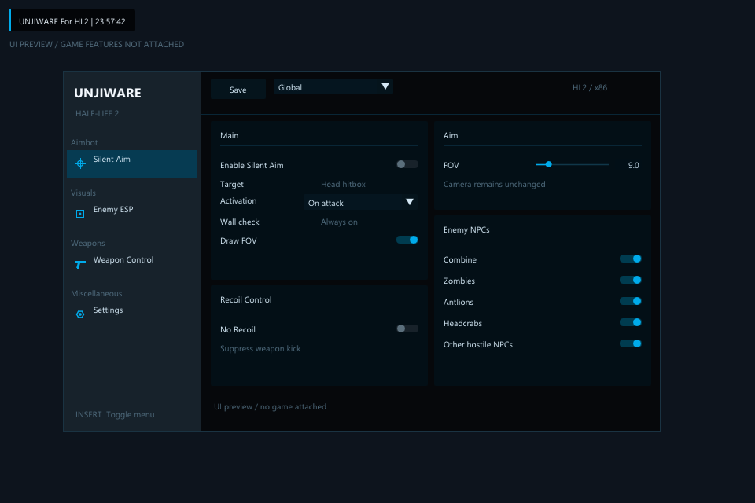

# HalfLife2 Aimbot UNJIWARE

C++ x86 DLL for Half-Life 2 single-player, with a DirectX 9 menu and hostile-NPC targeting.

[English](#english) · [한국어](#한국어)



## English

### Features

- **Insert** opens/closes the menu.
- Top-left `UNJIWARE For HL2 | HH:mm:ss` watermark.
- Hostile-NPC ESP: boxes, names, health and distance; Combine, zombies, antlions and headcrabs have separate filters.
- Birds, `enemyfinder`, `bullseye` and other script-only targets are excluded. Friendly NPCs are excluded using their current relationship to the player.
- Silent Aim changes the server's hitscan bullet direction while preserving the camera angle. It uses the head hitbox when available.
- No Spread and No Recoil for supported hitscan weapons.
- FOV drawing works independently of ESP and Silent Aim.

### Bullet reachability — R7

Target selection uses the same `MASK_SHOT` as the installed game's `FireBullets`, so bullet-passable grates do not block aim. Breakable glass is accepted only when its surface is glass, its entity is `func_breakable`, bullet penetration is permitted, and a reverse trace finds an exit within the game's 16-unit probe. Traversal is bounded to eight glass layers; ambiguous exits remain blocked.

Ordinary solid walls, penetration-disabled glass, thick glass and a solid wall behind glass remain blocked. Breaking an object on one shot does not automatically mean that the same shot penetrates it. The DLL predicts the game's existing behavior; it does not add damage or arbitrary wall penetration.

Aim checks the actual target point again for each shot. ESP uses a cheaper cached center-point check: **cyan** means a clear bullet trace, **orange** means the direct trace hit an obstacle, and **gray** means pending. Glass may therefore appear orange while the separate aim check permits a verified glass path.

ESP collection is capped at about 30 Hz. It avoids bone setup for boxes and limits visibility work to four traces per update, with 200 ms cached results. Exact head setup and glass traversal run when firing.

### Compatibility

- Windows, **x86 / 32-bit** `hl2.exe`.
- Steam build **19307283**, matching reviewed `hl2_complete` or `hl2` server/client DLL pairs.
- Default **DirectX 9** renderer.
- Module fingerprints and critical ABI offsets are checked before game hooks are enabled. A different build is reported in `UNJIWARE.log`.
- Projectile weapons such as the crossbow, RPG and grenades are outside the aim/spread implementation.

### Use

1. Start Half-Life 2 and load a single-player map.
2. Load the root `UNJIWARE.dll` with a 32-bit DLL injector. Alternatively, build and run `build\release\UNJIWARE-loader.exe`, which loads the DLL beside that loader.
3. Press **Insert** and enable the features you want. Check for **ready (R7)**.
4. **Save** writes `UNJIWARE.ini` beside the loaded DLL.

Completely restart the game before replacing a loaded DLL. The hooks live until process exit; duplicate injection does not update an existing copy.

### Build from CMD

The published build does not require Python or PowerShell. Install Node.js for the one-time dependency bootstrap; the pinned Zig compiler stays inside this project.

```bat
node tools\bootstrap.mjs
tar -xf .tools\zig.zip -C .tools
build.cmd
```

The build writes binaries to `build\release` and copies the finished **UNJIWARE.dll to the project root**. An optional output directory is supported:

```bat
build.cmd --output build\r7
```

Run the diagnostic checks with the local game installation path:

```bat
set "UW_HL2_DIR=D:\SteamLibrary\steamapps\common\Half-Life 2"
build.cmd --check
```

The ABI probe loads isolated copies of both game variants. The game probe exercises the production code through ABI-shaped test doubles; the UI probe checks FOV rendering. These checks are not a substitute for testing a new revision inside a live game map.

Dependencies are pinned to Zig **0.15.2**, Dear ImGui **v1.91.9b**, and MinHook **v1.3.4**. Bootstrap verifies the official Zig archive checksum. Third-party notices are in `licenses/`.

### Repository contents

`src/` contains the DLL, menu, loader and preview. `tools/*.cpp` contains diagnostics. `offsets/` records the reviewed build data. Python analysis scripts, downloaded SDK/toolchains, intermediate outputs, logs and local settings are excluded by `.gitignore`. The requested root DLL is intentionally included.

## 한국어

### 기능

- **Insert**로 메뉴 열기·닫기.
- 좌측 상단 `UNJIWARE For HL2 | HH:mm:ss` 워터마크.
- 적 NPC의 박스·이름·체력·거리 ESP. 콤바인·좀비·개미귀신·헤드크랩 필터 제공.
- 비둘기 등 조류와 `enemyfinder`, `bullseye` 같은 스크립트용 대상 제외. 현재 플레이어에게 우호적인 NPC도 제외합니다.
- 사일런트 에임은 카메라 각도를 유지하면서 서버의 히트스캔 탄환 방향을 바꿉니다. 머리 히트박스가 있으면 해당 위치를 사용합니다.
- 지원되는 히트스캔 무기의 No Spread·No Recoil.
- FOV 표시는 ESP·사일런트 에임과 독립적으로 동작합니다.

### 탄환 통과 판정 — R7

설치된 게임의 `FireBullets`와 같은 `MASK_SHOT`을 사용하므로 탄환이 통과하는 철망은 조준을 막지 않습니다. 유리는 표면 재질이 유리이고, `func_breakable`이며, 탄환 관통 금지 설정이 없고, 게임과 같은 16유닛 역방향 검사에서 출구가 확인되는 경우에만 허용합니다. 최대 8겹까지 검사하며 출구가 불명확하면 제외합니다.

일반 벽·관통 금지 유리·두꺼운 유리·유리 뒤의 일반 벽은 계속 차단합니다. 첫발에 물체가 부서진다고 그 탄환까지 관통하는 것은 아닙니다. 게임의 기존 탄환 동작을 예측하며, 임의의 벽 관통이나 추가 피해를 만들지 않습니다.

에임은 매 사격 때 실제 조준점까지 다시 검사합니다. ESP는 비용이 낮은 중심점 검사를 캐시합니다. **청록색**은 탄환 직선 검사 통과, **주황색**은 직선 경로의 장애물, **회색**은 검사 대기입니다. 따라서 유리가 주황색으로 보여도 별도의 에임 검사에서 유리 관통이 허용될 수 있습니다.

ESP 수집은 최대 약 30Hz이며 박스 표시용 뼈대 계산을 하지 않습니다. 시야 검사는 갱신당 최대 4회, 결과는 200ms 동안 재사용합니다. 정확한 머리 계산과 유리 통과 검사는 사격 시 실행합니다.

### 지원 환경

- Windows **32비트(x86) hl2.exe**.
- Steam 빌드 **19307283**, 검토된 `hl2_complete` 또는 `hl2`의 서버·클라이언트 DLL 조합.
- 기본 **DirectX 9** 렌더러.
- 게임 훅을 활성화하기 전에 모듈 지문과 주요 구조체 배치를 확인합니다. 다른 빌드이면 `UNJIWARE.log`에 표시합니다.
- 석궁·RPG·수류탄 등 투사체 무기의 에임·산포 보정은 지원하지 않습니다.

### 실행

1. Half-Life 2를 실행하고 싱글플레이 맵을 불러옵니다.
2. 32비트 인젝터로 프로젝트 맨 위의 `UNJIWARE.dll`을 로드합니다. 또는 빌드 후 `build\release\UNJIWARE-loader.exe`를 실행하면 로더 옆의 DLL을 로드합니다.
3. **Insert**를 누르고 필요한 기능을 켭니다. 하단의 **ready (R7)**를 확인합니다.
4. **Save**는 로드된 DLL 옆에 `UNJIWARE.ini`를 저장합니다.

새 DLL로 교체할 때는 게임을 완전히 종료하고 다시 실행하세요. 훅은 게임 종료까지 유지되며, 중복 인젝션으로 이미 로드된 DLL이 교체되지는 않습니다.

### CMD 빌드

공개 빌드는 Python·PowerShell 없이 동작합니다. 최초 의존성 준비에는 Node.js가 필요하며 Zig는 프로젝트 내부에 설치됩니다.

```bat
node tools\bootstrap.mjs
tar -xf .tools\zig.zip -C .tools
build.cmd
```

출력은 `build\release`에 생성되고, 완성된 **UNJIWARE.dll을 프로젝트 맨 위로 복사**합니다. `build.cmd --output build\r7`로 출력 폴더를 지정할 수 있습니다.

설치된 게임을 이용한 진단:

```bat
set "UW_HL2_DIR=D:\SteamLibrary\steamapps\common\Half-Life 2"
build.cmd --check
```

ABI 진단은 게임 DLL을 별도 프로세스에 로드합니다. 기능 진단은 실제 기능 코드를 ABI 대역으로 검사하고, UI 진단은 FOV 렌더링을 검사합니다. 새 버전의 실제 맵 동작과 FPS는 게임 안에서 별도로 확인해야 합니다.

Zig **0.15.2**, Dear ImGui **v1.91.9b**, MinHook **v1.3.4**를 사용하며 Zig 다운로드 체크섬을 확인합니다. 외부 라이선스는 `licenses/`에 있습니다.

### 저장소 구성

`src/`: DLL·메뉴·로더·미리보기. `tools/*.cpp`: 진단 코드. `offsets/`: 검토된 빌드 정보. Python 분석 파일·SDK·컴파일러·중간 산출물·로그·개인 설정은 `.gitignore`로 제외하고, 요청한 루트 DLL은 포함합니다.

## References / 참고 자료

- [Valve Source SDK 2013 singleplayer](https://github.com/ValveSoftware/source-sdk-2013/tree/singleplayer)
- [Bullet and glass handling](https://github.com/ValveSoftware/source-sdk-2013/blob/singleplayer/src/game/shared/baseentity_shared.cpp)
- [Glass exit tracing](https://github.com/ValveSoftware/source-sdk-2013/blob/singleplayer/src/game/server/ai_basenpc.cpp)
- [Dear ImGui](https://github.com/ocornut/imgui)
- [MinHook](https://github.com/TsudaKageyu/minhook)
